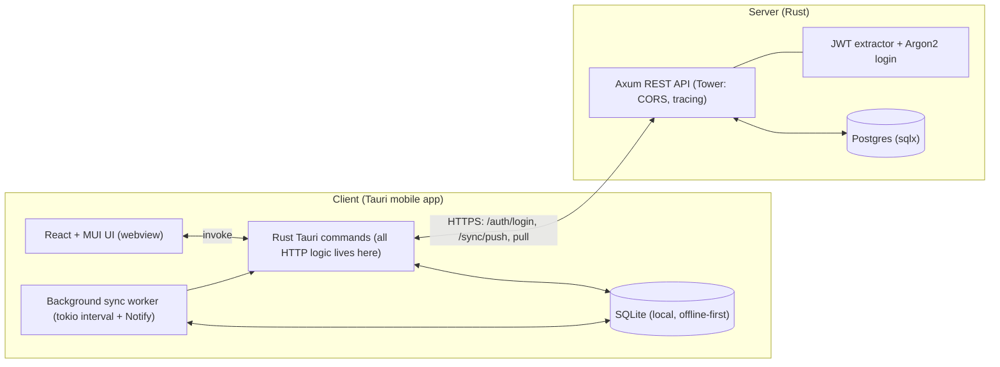
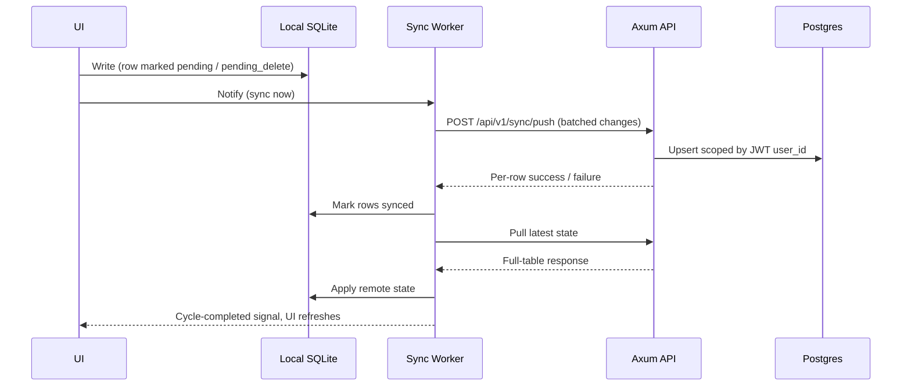

# TrackMe Fitness — Offline-First Full-Stack Workout Tracker

**Tauri + React client, Axum + Postgres server, custom background sync engine.**

> *Repository is private — possible future monetization*

---

## Overview

TrackMe Fitness is an **offline-first mobile workout tracker** that unifies lifting and running in a single app. Built solo as a deliberate deep dive into Rust, async Rust, the Tauri ecosystem, and designing a real client/server system from the ground up.

**The problem:** Most fitness apps treat running and strength training as separate worlds. I wanted one unified tracker so historical effort and recent training load live in the same place — making it possible to plan sensibly and avoid overtraining injuries.

**The engineering motivation:** My previous large Rust project (a ray tracer) had a single computational goal. I wanted the opposite: a long-lived, stateful, networked system with users, persistence, auth, and failure modes that only show up in real deployments.

### What It Does

- **Log lifting sessions and runs** in a single unified app
- **Works offline** — all data lives in a local SQLite database
- **Syncs automatically in the background** to a central Postgres database via REST API
- **Multi-device** — log in on any device and see the same data; edits propagate across devices
- **Secure authentication** with Argon2 password hashing and JWT-based sessions
- **Clean sign-out** that wipes local user data and returns to login state

---

## Screenshots

<ProjectCarousel
  images='[
    {"src":"/images/trackme-fitness/loading.png","alt":"Loading screen","caption":"App loading screen"},
    {"src":"/images/trackme-fitness/dash.png","alt":"Dashboard","caption":"Unified dashboard — lifting + running"},
    {"src":"/images/trackme-fitness/login.png","alt":"Login screen","caption":"Secure authentication with Argon2 + JWT"},
    {"src":"/images/trackme-fitness/lifting.png","alt":"Lifting session","caption":"Lifting tracker with sets/reps/RPE"},
    {"src":"/images/trackme-fitness/running.png","alt":"Running session","caption":"Running tracker with distance/pace"},
    {"src":"/images/trackme-fitness/month.png","alt":"Month view","caption":"Monthly training overview"},
    {"src":"/images/trackme-fitness/backend_status.png","alt":"Backend status","caption":"Deployed Axum backend on Render"}
  ]'
  defaultIndex={0}
  showThumbnails={true}
/>

---

## Highlights

| Area | What I Built |
|------|--------------|
| **Offline-first sync engine** | Background worker pushes batched local changes and pulls server state, with per-row success/failure reporting so one bad row never fails a whole batch |
| **Production deployment** | Axum backend deployed to Render on a custom subdomain, phone app talking to it |
| **Deliberate sequencing** | Complexity added in stages: simple full-table sync first, auth layered on after sync was proven |
| **Async optimization** | Parts of the full-stack app heavily optimized — up to 4x wall time improvement — by restructuring async Rust (i.e. setting up multiple futures and awaiting all at once vs. sequentially) |
| **Concurrency safety** | Sync cycles guarded by an atomic flag with an RAII `Drop` guard, so overlapping syncs are impossible and a panic can never leave the guard stuck |
| **Startup coordination** | App initialization modeled as an explicit `InitStage` state machine broadcast over `tokio::sync::watch` channels |
| **Responsive sync** | Writes trigger immediate sync via `tokio::sync::Notify`; UI waits on a cycle-completed signal before showing fresh data |
| **Security** | Argon2 password hashing, constant-work login (dummy-hash verification for unknown users), identical errors for bad username vs. bad password, JWT-derived identity on every endpoint |
| **Data isolation** | `user_id` taken only from verified JWT, never from request payloads. Every endpoint filters by it; foreign keys cascade on delete |

---

## Architecture

### System Diagram



**Key idea:** The webview never talks to the network. The UI only invokes Rust commands, and Rust owns all HTTP, token handling, and sync. This keeps security-sensitive logic in typed, testable Rust rather than scattered through frontend code.

### Sync Flow



---

## Tech Stack

**Client**
- Tauri (mobile), Rust backend layer
- React + TypeScript + MUI
- SQLite via `sqlx`
- Tokio

**Server**
- Rust, Axum, Tokio
- Postgres via `sqlx`
- Tower middleware (`CorsLayer`, `TraceLayer`)
- `argon2` for password hashing, JWT for sessions
- Error handling: `thiserror` for request-handling errors mapped to HTTP responses, `anyhow` for startup/pre-server failures

**Infrastructure**
- Docker Compose for local Postgres (Axum runs natively during development)
- Render for deployed backend

---

## Deep Dives

### 1. Offline-First Sync Engine

Every local row carries a `sync_status` column constrained to `synced`, `pending`, or `pending_delete`, enforced with a SQL `CHECK`. The soft-delete state means deletions can be pushed to the server before the row is removed locally.

Local changes go to the server in a **single batched endpoint** (`POST /api/v1/sync/push`) that returns **per-row results**. This avoids chatty per-record requests and lets the client mark exactly which rows succeeded.

```rust
// Simplified sync push handler (server-side)
#[derive(Deserialize)]
struct PushRequest {
    lifting_sessions: Vec<LiftingSessionPayload>,
    running_sessions: Vec<RunningSessionPayload>,
    // ... other tables
}

#[derive(Serialize)]
struct PushResponse {
    lifting_sessions: Vec<RowResult>,
    running_sessions: Vec<RowResult>,
    // ...
}

#[derive(Serialize)]
struct RowResult {
    local_id: i64,
    server_id: Option<i64>,
    success: bool,
    error: Option<String>,
}
```

The client applies results row-by-row — failed rows stay `pending` and retry next cycle.

---

### 2. Async Rust Concurrency, Done Carefully

The background worker runs on `tauri::async_runtime::spawn` with a `tokio::time::interval`. Key patterns:

**InitStage state machine** — shared via `tokio::sync::watch`:
```rust
#[derive(Debug, Clone, Copy, PartialEq, Eq)]
enum InitStage {
    NotStarted,
    DbReady,
    AuthReady,
    SyncWorkerStarted,
    Ready,
}

// In AppState:
init_tx: watch::Sender<InitStage>,
init_rx: watch::Receiver<InitStage>,
```

Only the owner holds the `Sender`; consumers clone the `Receiver`. Nothing outside can mutate it.

**Sync trigger + completion signaling** — `tokio::sync::Notify` + RAII guard:
```rust
// Trigger immediate sync after local write
sync_notify.notify_one();

// In worker loop:
tokio::select! {
    _ = interval.tick() => run_sync_cycle().await,
    _ = sync_notify.notified() => run_sync_cycle().await,
}

// RAII guard ensures flag is cleared even on panic
struct SyncGuard(AtomicBool);

impl Drop for SyncGuard {
    fn drop(&mut self) {
        self.0.store(false, Ordering::Release);
    }
}

async fn run_sync_cycle(&self) {
    let _guard = SyncGuard(self.syncing.swap(true, Ordering::Acquire));
    // ... do sync work ...
    // guard drops here, flag cleared automatically
    cycle_complete.notify_one();
}
```

**UI waits for exactly one fresh cycle** after a write:
```rust
// Tauri command invoked after local insert
#[tauri::command]
async fn wait_for_sync(state: State<'_, AppState>) -> Result<(), String> {
    state.cycle_complete.notified().await;
    Ok(())
}
```

---

### 3. Authentication & Data Isolation

**Password hashing** — Argon2 with default params:
```rust
use argon2::{Argon2, PasswordHash, PasswordVerifier};

fn verify_password(password: &str, hash: &str) -> Result<bool, argon2::Error> {
    let parsed_hash = PasswordHash::new(hash)?;
    Ok(Argon2::default().verify_password(password.as_bytes(), &parsed_hash).is_ok())
}
```

**Constant-work login** — dummy hash verification for unknown users:
```rust
async fn login(pool: &PgPool, creds: LoginRequest) -> Result<LoginResponse, AuthError> {
    let user = sqlx::query_as!(User, "SELECT * FROM users WHERE username = $1", &creds.username)
        .fetch_optional(pool)
        .await?;

    // Always do comparable work — dummy hash if user not found
    let hash = user.as_ref().map(|u| &u.password_hash).unwrap_or(&DUMMY_ARGON2_HASH);
    let valid = verify_password(&creds.password, hash)?;

    if !valid || user.is_none() {
        return Err(AuthError::InvalidCredentials); // identical error
    }

    let token = create_jwt(user.unwrap().id)?;
    Ok(LoginResponse { token })
}
```

**JWT extractor** — custom Axum extractor on every protected endpoint:
```rust
#[derive(Clone)]
struct AuthUser {
    user_id: Uuid,
}

#[async_trait]
impl<S> FromRequestParts<S> for AuthUser
where
    S: Send + Sync,
{
    type Rejection = AuthError;

    async fn from_request_parts(parts: &mut Parts, _state: &S) -> Result<Self, Self::Rejection> {
        let token = parts
            .headers
            .get(header::AUTHORIZATION)
            .and_then(|h| h.to_str().ok())
            .and_then(|s| s.strip_prefix("Bearer "))
            .ok_or(AuthError::MissingToken)?;

        let claims = decode_jwt(token)?;
        Ok(AuthUser { user_id: claims.sub })
    }
}

// Usage — every protected handler:
async fn push_sync(
    auth: AuthUser,
    Json(payload): Json<PushRequest>,
) -> Result<Json<PushResponse>, ApiError> {
    // auth.user_id is guaranteed valid and scoped
    // ... upsert with ON CONFLICT (id, user_id) DO UPDATE ...
}
```

**`user_id` never from request body** — every SQL query filters by `auth.user_id`:
```rust
sqlx::query!(
    "INSERT INTO lifting_sessions (user_id, ...) VALUES ($1, ...)
     ON CONFLICT (id, user_id) DO UPDATE SET ...",
    auth.user_id,
    // ... other fields
)
.execute(pool)
.await?;
```

---

## Key Technical Decisions

### 1. Full-Table Sync Before Hash-Based Diffing

Deliberate choice during Phase 3 (Backend + Sync, No Auth). Full-table pulls are simple and correct, removing variables while integrating. Diffing is a documented upgrade path — not a missing feature.

### 2. Deliberate Complexity Sequencing (8 Phases)

| Phase | Scope | Isolation Principle |
|-------|-------|---------------------|
| 1. Client Prototype | UI + data modeling only | Settle shape *before* storage |
| 2. Local Persistence | SQLite + data model | Prove offline works *before* networking |
| 3. Backend + Sync | Axum + Postgres + batched push/pull | Get sync working *without* auth |
| 4. Local Integration | Docker Postgres + native server | Fast iteration, easy inspection |
| 5. Temporary Auth | JWT extractor + temp token endpoint | Prove isolation *before* real credentials |
| 6. Real Login | Argon2 `/auth/login`, demo accounts | Replace scaffolding *after* plumbing trusted |
| 7. Sign-out + Polish | Wipe local data, immediate sync, cycle signaling | Full lifecycle feels solid |
| 8. Mobile + Deploy | Phone build, Render deploy, multi-account test | Architecture holds on real device/host |

### 3. Security-First Auth Design

- **No username enumeration** — identical errors + constant work
- **Token-only identity** — `user_id` from JWT claim, never request payload
- **Row-level isolation** — every query scoped by `user_id`; FK cascades on delete
- **No token persistence on client** — fetched on demand at login
- **No registration endpoint** — demo accounts seeded directly in DB

---

## What I Learned

- **Async Rust in a real application** — cancellation, shared state, guard types, and channel selection (`watch` vs `Notify` vs atomics) are very different from toy examples
- **Rust is a viable end-to-end web stack** — for someone proficient in Rust async, the ecosystem (Axum, sqlx, Tower) closes most of the shipping-speed gap with TypeScript
- **Designing for failure** — per-row sync results, panic-safe guards, and constant-work login all came from asking "what happens when this goes wrong?"
- **Don't overengineer at the start** — This is a big one for me and honestly I'd need a whole page for this. I'd compare it to making a sculpture — you don't immediately dig for the fine details immediately. That drains a lot of wasted effort, resources, and frankly your own sanity. Instead you make a high-level plan and start iterating on the whole sculpture. Once you see it coming togther, only then do you start planning further and refining the smaller components.
- **Sequencing is a skill** — deferring complexity on purpose made every integration step debuggable

---

## How I Used AI

I used AI on this project, and I used it deliberately. The goal here was to **learn Rust async, Tauri, and client/server sync patterns by building them myself**, so I set a rule for how AI could and couldn't be involved.

### What I Used AI For

- **High-level planning and design discussion.** Weighing options for sync strategy, auth design, and concurrency primitives, and pressure-testing trade-offs before committing. It worked as a sounding board, not a decision-maker.
- **Navigating documentation.** Instead of reading through large crate and framework docs to find the one relevant API, I could ask targeted questions and get pointed to the right place quickly.

### What I Did Myself

- **Wrote almost all of the code directly.** The sync worker, the guard types, the Axum handlers, the auth flow, the schema, and the Tauri commands were all written by hand. I did not use AI to generate the implementation.
- **Made the decisions.** Every call in the [decision log](#key-technical-decisions) was mine, and I pushed back when a suggestion didn't fit my actual constraints. For example, I rejected the conventional `models/` layout in favor of keeping response structs next to their handlers so sensitive fields are auditable at a glance.
- **Debugged and tested it.** For instance, I verified cross-user isolation by swapping identities and confirming each user only saw their own entries, then tested multiple accounts against the deployed backend and the phone build. The entire app was built this way, with desktop testing to test the interface and ensure data consistency in multiple scenarios.

### Why I Drew the Line There

If AI writes the code, I learn what the AI knows, not what I need to know. Writing it myself is what built real understanding of things like why a `Drop` guard makes a sync flag panic-safe, or when `watch` is the right channel versus `Notify`. Using AI for planning and docs sped me up without taking away the part that teaches.

### How I'd Work Differently on a Team

On a project like this, where the goal is skill-building, I chose to limit AI's role. In a professional setting, the goal is different: shipping quickly and reliably. There I would **use AI for most of the direct code generation** to raise development velocity.

What stays the same is **ownership**. I would still:

- Understand the code and the design decisions well enough to defend them in review
- Stay an active participant in architecture and trade-off calls, not a passive approver of generated output
- Catch problems in generated code (concurrency bugs, security gaps, wrong assumptions) because I know how those systems fail

This project is where I built that foundation. Reviewing and steering AI-written code well requires the same understanding as writing it, and I built that by writing this one myself.

---

## What I'd Do Differently

### 1. Choose a Lighter Frontend Stack (Biggest Regret)

React + MUI + Next.js was familiar but heavier than needed. The UI wasn't where I wanted to spend learning time, yet it's where I felt the cost most: much of the client prototype phase went into iterating on the interface, and the stack made each iteration slower. A lighter framework built for fast prototyping would have been the better fit. I'd pick the frontend for iteration speed first, familiarity second.

### 2. Use Finer-Grained State Locking on the Client

The client's shared app state sits behind a single `std::sync::Mutex`, so any worker touching state holds the lock for *all* of it. In practice this is a user-facing app with little compute, so real-world impact is near zero — but in a system with heavier workloads, I'd split state into independently locked pieces or use interior mutability on individual fields.

### 3. Design for Async from the Start

I didn't plan around the rule that a `std` mutex guard shouldn't be held across `.await`. Retrofitting that meant working through compiler constraints after the fact — far more painful than designing for it from day one. In places where a full refactor cost too much time, I fell back on `tokio::block_on`, a trade-off I'd rather have designed away.

---

## Future Work

- **User registration system** — validation, duplicate handling, secure credential creation
- **More robust statistics tracking** — deeper analysis of training history and recent load, building toward planning around historical effort and avoiding overtraining
- **Hash-based sync diffing** — per-bucket hashing of `(id, updated_at)` pairs, potentially evolving into hierarchical (Merkle-style) comparison so client only pulls what changed
- **Hash verification in sync responses** — reusing the same hashing infrastructure
- **Integration test suite** for API and sync paths

---

## Demo

[View Repository]() — *private repository*

> **Note:** The source repository is private (possible future monetization). Screenshots above demonstrate the running application. The deployed backend runs on Render under a custom subdomain; the mobile app builds and runs on physical devices against it.
